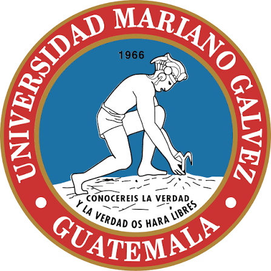

# Universidad Mariano Gálvez de Guatemala

### Facultad de Ingeniería en Sistemas de Información

**Curso:** Seguridad en Aplicaciones

 

# TAREA #6
## Auditoría y Endurecimiento de APIs y microservicios

  

| | |
|---|---|
| **Estudiante** | Emilio Andrés Hernández |
| **Carné** | 1593-20-19375 |
| **Correo** | ehernandez10@miumg.edu.gt |
| **Catedrático** | Luis Enrique Rivas Ventura |
| **Curso** | Seguridad en Aplicaciones |

 

**Repositorio:** https://github.com/emiliohernandezdev/t6-lab-seg-aplicaciones

---

## Contenido

1. [README.md](README.md) — cómo levantar el laboratorio, correr las pruebas y mapa de evidencias.
2. [hallazgos.md](hallazgos.md) — hallazgos de seguridad (crAPI y el servicio propio), con corrección y evidencia.
3. [caso_optus.md](caso_optus.md) — matriz que relaciona el caso Optus con el laboratorio.

### Material de apoyo

- `src/` — código del servicio de pedidos (FastAPI + GraphQL).
- `gateway/`, `keycloak/`, `docker-compose.yml` — gateway, identidad y orquestación.
- `tests/` — pruebas automatizadas (pytest, 75 casos).
- `scripts/` — generación de certificados, tokens y evidencias.
- `evidencias/` — solicitudes y respuestas (antes/después), con tokens ocultos.
