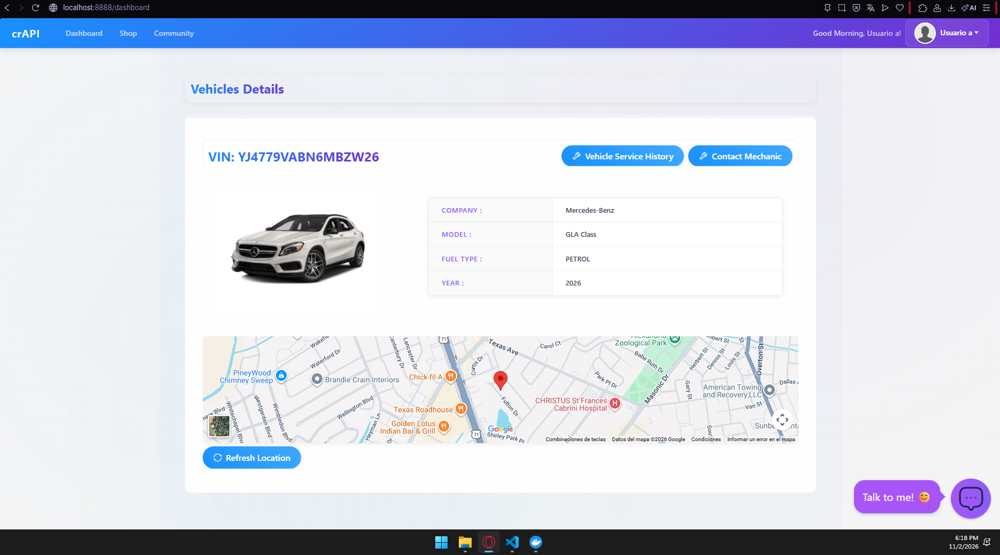

# Inventario de endpoints – crAPI

Observado en mi propio tráfico (curl) iniciando sesión con Usuario A y Usuario B.
- crAPI: commit `b5fc307` (2026-09-09), levantado en `C:\labs\crAPI\deploy\docker`
- Base: `http://localhost:8888`
- Fecha de captura: 2026-11-03

| # | Método | Ruta | Parámetros relevantes | Autenticación | Qué devuelve |
|---|---|---|---|---|---|
| 1 | POST | `/identity/api/auth/signup` | name, email, number, password | ninguna | confirmación de registro |
| 2 | POST | `/identity/api/auth/login` | email, password | ninguna | JWT (`token`) |
| 3 | GET | `/identity/api/v2/user/dashboard` | – | Bearer JWT | id, name, email, number, credit, role |
| 4 | POST | `/identity/api/v2/vehicle/add_vehicle` | vin, pincode | Bearer JWT | registra el vehículo del usuario |
| 5 | GET | `/identity/api/v2/vehicle/vehicles` | – | Bearer JWT | vehículos del usuario (incluye `uuid`) |
| 6 | GET | `/identity/api/v2/vehicle/{uuid}/location` | uuid (path) | Bearer JWT | ubicación GPS, nombre y correo (**H1 – BOLA**) |
| 7 | GET | `/community/api/v2/community/posts/recent` | limit, offset | Bearer JWT | posts con `email` y `vehicleid` del autor (**H2**) |
| 8 | GET | `/workshop/api/shop/products` | – | Bearer JWT | catálogo y crédito |
| 9 | GET | `/workshop/api/mechanic/` | – | Bearer JWT | lista de mecánicos (código y correo) |
| 10 | GET | `/workshop/api/mechanic/mechanic_report` | report_id (query, secuencial) | Bearer JWT | reporte con VIN, correo y teléfono del dueño (**H1b – BOLA**) |
| 11 | POST | `/community/api/v2/community/posts` | title, content | Bearer JWT | post creado |
| 12 | GET | `/workshop/api/shop/orders` | limit, offset | Bearer JWT | pedidos del usuario |

## crAPI funcionando (punto 1)

Dashboard de crAPI con la sesión de Usuario A (`localhost:8888/dashboard`), mostrando
su vehículo (VIN `YJ4779VABN6MBZW26`) y la ubicación en el mapa:

## Archivos de evidencia (tokens recortados a `eyJ…[OCULTO]`)

- `entorno.txt` — `docker --version`, SO y `docker compose ps` de crAPI (punto 1)
- `crapi_funcionando.png` — captura de crAPI en el navegador (`localhost:8888/dashboard`), sesión de Usuario A, con el vehículo VIN `YJ4779VABN6MBZW26` y su ubicación en el mapa
- `recon_dashboard_A.txt`, `recon_shop_products.txt`, `recon_mechanics.txt` — reconocimiento
- `H2_community_posts_recent.txt` — exposición de datos
- `H1_location_propio_A.txt` + `H1_location_vehiculo_B.txt` — par BOLA (objeto propio vs. ajeno)
- `H1b_mechanic_report_1.txt` — BOLA por id secuencial
- `neg_location_sin_token.txt` — control negativo (401)

Todo esto se regenera con `bash scripts/evidencias_crapi.sh` (con crAPI arriba y los dos usuarios creados).
