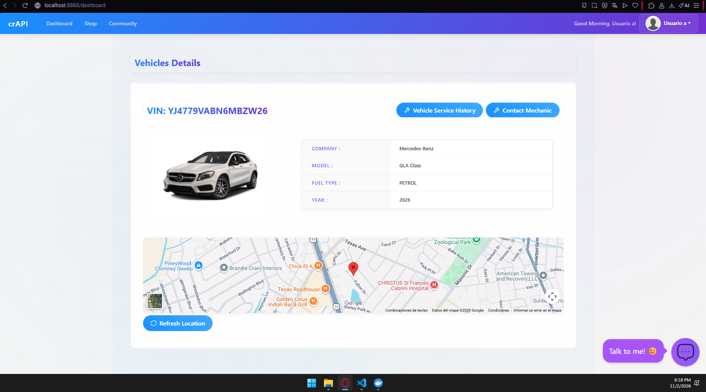

# Hallazgos

Inventario de endpoints de crAPI: [evidencias/crAPI/inventario_endpoints.md](evidencias/crAPI/inventario_endpoints.md)

## Bloque A – crAPI

Reproducido con dos usuarios de prueba (`usuarioa@lab.local`, `usuariob@lab.local`),
ambos con un vehículo registrado con el VIN y pincode que crAPI envía por correo
(MailHog). Entorno y `docker compose ps` en `evidencias/crAPI/entorno.txt`;
captura de crAPI funcionando (sesión de A, con su vehículo y ubicación) en
`evidencias/crAPI/crapi_funcionando.png`:

### H1 – BOLA en la ubicación del vehículo
- **Endpoint:** `GET /identity/api/v2/vehicle/{vehicleId}/location`
- **Condición:** el servidor no comprueba que el vehículo pertenezca al usuario del token; basta cambiar el `uuid` del vehículo.
- **Impacto:** con la sesión de A se obtiene la ubicación GPS, el nombre y el correo del vehículo de B (HTTP 200).
- **Evidencia:** `evidencias/crAPI/H1_location_propio_A.txt` (A sobre su vehículo, baseline) y `H1_location_vehiculo_B.txt` (A sobre el vehículo de B). Control negativo sin token: `neg_location_sin_token.txt` (401).
- **Corrección:** validar el dueño del objeto contra el `sub` del token. Aplicado en mi servicio en `GET /api/orders/{id}` (ver H4).

### H1b – BOLA en el reporte del mecánico (IDs secuenciales)
- **Endpoint:** `GET /workshop/api/mechanic/mechanic_report?report_id=N`
- **Condición:** el `report_id` es secuencial y no se valida la propiedad; A lee el reporte `1`.
- **Impacto:** se expone el VIN, el correo y el teléfono del dueño del reporte (en la semilla, los del usuario `admin`).
- **Evidencia:** `evidencias/crAPI/H1b_mechanic_report_1.txt` (HTTP 200).
- **Corrección:** misma que H1 (dueño del objeto = `sub`) y además evitar identificadores secuenciales predecibles.

### H2 – Exposición excesiva de datos en el feed de la comunidad
- **Endpoint:** `GET /community/api/v2/community/posts/recent`
- **Condición:** cada post incluye datos del autor que la pantalla no muestra: `email` y `vehicleid`.
- **Impacto:** cualquier usuario autenticado recolecta correos e IDs de vehículos ajenos, que es justo lo que habilita H1.
- **Evidencia:** `evidencias/crAPI/H2_community_posts_recent.txt`
- **Corrección:** modelo de respuesta con lista blanca. En mi servicio, `ProfileOut` (ver H6).

> La **asignación masiva** (propiedades que solo debería controlar el servidor) se
> demuestra de forma controlada en mi propio servicio: ver H7 (`PATCH /api/profile`
> con `role=admin`), con evidencia antes/después y prueba automatizada.

## Bloque B – mi servicio (antes de corregir, `INSECURE_MODE=true`)

### H4 – BOLA en pedidos
- **Endpoint:** `GET /api/orders/{id}`
- **Condición:** solo se buscaba el pedido por id, sin comparar el dueño.
- **Impacto:** usuarioa lee el pedido 3 de usuariob, con dirección y artículos (200).
- **Evidencia:** `evidencias/BOLA_BFLA/antes.txt` → `despues.txt`
- **Corrección:** `owner_id == sub` y 404 en caso contrario. Prueba: `test_bola_bfla.py`.

### H5 – BFLA en auditoría
- **Endpoint:** `GET /api/admin/audit`
- **Condición:** la ruta solo exigía estar autenticado.
- **Impacto:** un usuario común lee la auditoría (200).
- **Evidencia:** `evidencias/BOLA_BFLA/antes.txt` → `despues.txt` (403)
- **Corrección:** `require_role("admin")` en el servidor.

### H6 – Exposición de datos en el perfil
- **Endpoint:** `GET /api/profile`
- **Condición:** se devolvía el registro completo.
- **Impacto:** salen `password_hash`, `role`, `internal_notes` y `payment_card`.
- **Evidencia:** `evidencias/BOLA_BFLA/antes.txt` → `despues.txt`
- **Corrección:** `ProfileOut` (username, full_name, email, address).

### H7 – Asignación masiva en el perfil
- **Endpoint:** `PATCH /api/profile`
- **Condición:** `profile.update(payload)` con todo lo que llegaba en el body.
- **Impacto:** usuarioa se pone `role=admin` / `is_admin=true` y queda guardado.
- **Evidencia:** `evidencias/BOLA_BFLA/antes.txt` → `despues.txt` (422 y el perfil releído sin cambios)
- **Corrección:** `ProfileUpdate` con `extra="forbid"`.

### H8 – JWT decodificado pero no validado
- **Endpoint:** todos los protegidos
- **Condición:** `jwt.decode(..., verify_signature=False)`.
- **Impacto:** se aceptan tokens con el payload alterado (rol admin inyectado), `alg=none`, de otro realm, ID tokens y tokens vencidos.
- **Evidencia:** `evidencias/JWT_OIDC/antes.txt` → `despues.txt`
- **Corrección:** RS256 contra la JWKS de Keycloak, `iss`, `aud`, `exp` y `typ=Bearer`, más scopes por endpoint. Prueba: `test_jwt.py`.

### H9 – Pedidos sin validación de esquema
- **Endpoint:** `POST /api/orders`
- **Condición:** sin contrato. Se coercionan tipos y se aceptan campos extra.
- **Impacto:** se crean pedidos con `quantity` 0 u 11, con `"5"` como texto o sin dirección. Con `"price": 0` el pedido queda gratis.
- **Evidencia:** `evidencias/esquema_rate_limit/antes.txt` → `despues.txt`
- **Corrección:** `OrderCreate` (`strict`, `extra="forbid"`, rangos). Prueba: `test_schema.py`.

### H10 – Sin límite de tasa
- **Endpoint:** `GET /api/orders/{id}`
- **Condición:** no había ningún límite.
- **Impacto:** enumeración ilimitada de IDs.
- **Evidencia:** `evidencias/esquema_rate_limit/antes.txt` → `despues.txt` (la petición 11 da 429)
- **Corrección:** ventana deslizante por `sub` (10/10 s) y `limit_req` en el gateway.

### H11 – GraphQL sin límites
- **Endpoint:** `POST /graphql`
- **Condición:** sin límite de profundidad, de listas ni de costo, con la introspección abierta y sin control de dueño en los resolvers.
- **Impacto:** consultas de profundidad 6, `first: 50`, consultas de alto costo, introspección completa y el pedido de B visible para A.
- **Evidencia:** `evidencias/graphql/antes.txt` → `despues.txt`
- **Corrección:** `QueryDepthLimiter(3)`, regla de costo, `first ≤ 20`, introspección desactivada en prod y autorización en los resolvers. Prueba: `test_graphql.py`.
